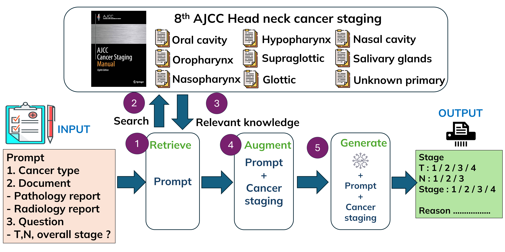

# A Local RAG-LLM Framework for Head and Neck Cancer

This research project evaluates the capability of open-source Large Language Models (LLMs) in automating staging for head and neck cancer (HNC) using a local Retrieval-Augmented Generation (RAG) framework. The goal is to address the issue of missing staging data in cancer registries (which typically lacks for 20-30% of cases) while ensuring data privacy through local deployment

---

## Data pipeline

---

## 🛠️ Models Evaluated

The study tested various open-source models across different scales, as well as a proprietary commercial model:

* **Small-Scale (7-8B):**
  * Mistral (7B)
  * DeepSeek (7B)
  * Qwen (8B)
* **Medium-Scale (14-27B):**
  * Phi (14B)
  * GPT-OSS-20B (20B)
  * MedGemma (27B)
* **Large-Scale (70-120B):**
  * Llama 3.3 (70B)
  * Qwen3-Next (120B)
  * GPT-OSS-120B (120B)
* **Proprietary API:**
  * GPT-5-mini

---
